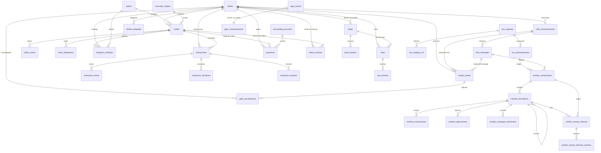
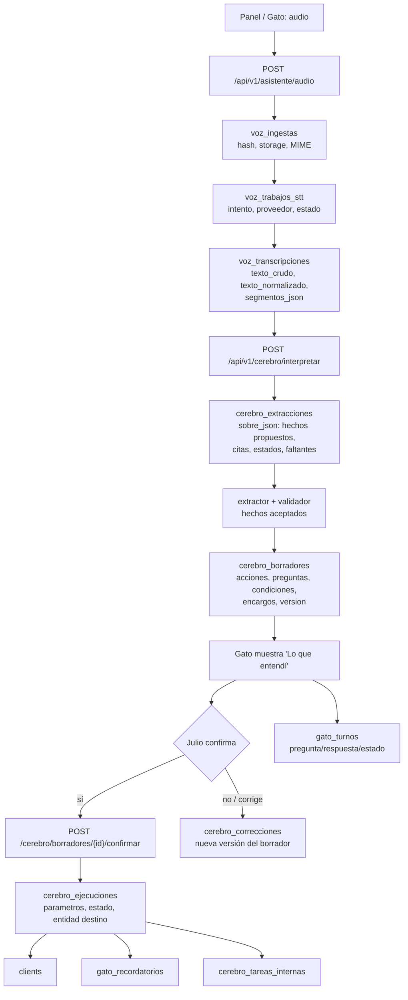

# Mapa técnico de las bases de datos de Horminor

> **Estado:** diagnóstico del esquema real y del código al 2026-11-19.
> **Alcance:** PostgreSQL de Horminor (esquema `public`), migraciones y módulos
> que leen/escriben. **No incluye** credenciales, valores de filas ni datos
> personales reales.
>
> **Para quién es:** para Astra y Gemini Neon, antes de implementar la memoria e
> historial de Gato. Responde a sus dos solicitudes: mapa completo verificado
> (Astra) e inventario exacto agrupado por Conversaciones, Borradores/Staging,
> Negocio y Otros (Gemini).
>
> **Regla:** lo que no está aquí no se asume. Si hay contradicción entre este
> documento y el código, gana el código y se pregunta.

---

## 1. Método y fuentes verificables

Se inspeccionó el esquema real, no solo las migraciones:

- `pg_dump --schema-only --no-owner --no-privileges` de la base local
  `orminorth` (PostgreSQL 15).
- `information_schema.tables`, `information_schema.columns`,
  `information_schema.table_constraints` y `information_schema.key_column_usage`.
- `pg_indexes`, `pg_constraint` (PK, UNIQUE, CHECK) y comentarios de tablas.
- Migraciones `db/migrations/001_*.sql` a `097_cita_eventos.sql`.
- Búsqueda en `services/core-api/app` de `FROM`, `JOIN`, `INSERT INTO`,
  `UPDATE` y `DELETE FROM` para atribuir lecturas y escrituras por módulo.

Resultado del esquema real:

- **67 tablas** base.
- **11 vistas**.
- **84 llaves foráneas**.
- **190 índices**.
- **252 restricciones** PK/UNIQUE/CHECK.

> Los conteos de filas no se incluyen para no exponer actividad ni datos. El
> esquema es el mismo en local y en el VPS; el VPS es la copia operativa.

---

## 2. Resumen ejecutivo

Horminor tiene tres mundos que no se deben confundir:

1. **Gato** — la conversación del asistente:
   - `gato_turnos`: pregunta/respuesta por `conversacion_id`.
   - `gato_recordatorios`: recordatorios/tareas programadas; ya tiene
     `conversacion_id` y `cliente_id`.
2. **Cerebro** — la interpretación del dictado:
   - `voz_*`: audio, intentos STT y transcripción.
   - `cerebro_extracciones`: la extracción cruda del LLM (`sobre_json`).
   - `cerebro_borradores`: acciones, preguntas, condiciones y encargos.
   - `cerebro_ejecuciones`: lo confirmado y ejecutado.
   - `cerebro_tareas_internas`: tareas internas; **no tienen `cliente_id`**.
3. **CRM/Agenda** — el negocio:
   - `clients`, `orders`, `cotizaciones`, `dispatch_schedule`,
     `mixer_dispatches`, `payments`, etc.
   - `chat_conversaciones`/`chat_mensajes` son el **hilo de WhatsApp por
     cliente**, no la conversación de Gato.

Hallazgos que importan para la memoria e historial:

- **No existe `gato_conversaciones`.** `gato_turnos.conversacion_id` es un UUID
  suelto, sin cabecera, sin `cerrada_en` y sin FK.
- **El panel no pinta `gato_turnos`.** El backend recuerda, pero la ventana
  aparece vacía; por eso parece que no hay historial.
- **`cerebro_borradores` no tiene `conversacion_id` ni `cliente_id`.**
- **`cerebro_tareas_internas` no tiene `cliente_id`.**
- **`gato_recordatorios` sí tiene `conversacion_id` y `cliente_id`.**
- **No hay tabla de contactos del cliente ni de obras.** Los contactos se
  extraen como hechos `contacto.*` en `sobre_json`; al crear el cliente solo se
  guardan nombre, cédula, teléfono, ciudad y dirección.
- **`client_facts` y `client_fact_supersedes` existen en el esquema, pero hoy no
  tienen lecturas ni escrituras en `app/`.** Son diseño adelantado, no memoria
  operativa.
- **No hay un sistema general de etiquetas.** Las etiquetas normalizadas están
  en `cliente_etiquetas`; `media_assets.etiquetas` es JSONB. No hay etiquetas de
  conversación.

---

## 3. Diagrama de relaciones

> Diagrama simplificado de las relaciones que importan para Gato/Cerebro. El
> inventario de la sección 5 cubre las 67 tablas.



> La última línea es intencional: muestra la relación que **falta**. No hay
> tabla `gato_conversaciones`; `gato_turnos` solo guarda el UUID.

---

## 4. Flujo desde que Julio dicta un audio hasta que queda confirmado



Pasos, con la tabla que escribe cada uno:

1. **Audio.** El panel envía `multipart` a `/api/v1/asistente/audio`.
   `voz_ingestas` guarda hash, ruta, MIME y tamaño. No guarda el binario en
   PostgreSQL: vive en Bunny o en el sandbox local.
2. **Transcripción.** `voz_trabajos_stt` registra cada intento; al terminar,
   `voz_transcripciones` guarda `texto_crudo`, `texto_normalizado`,
   `segmentos_json` (palabras y tiempos) y confianza.
3. **Interpretación.** El puente entrega el texto a
   `/api/v1/cerebro/interpretar`. `cerebro_extracciones` guarda el `sobre_json`
   crudo del LLM: intención, hechos propuestos, citas, estados, faltantes,
   ambigüedades y preguntas.
4. **Validación.** El extractor valida cada cita contra el texto y descarta lo
   que no se sostiene. Los hechos aceptados se compilan.
5. **Borrador.** `cerebro_borradores` guarda acciones, preguntas, condiciones y
   encargos. **No guarda una columna de hechos**: los hechos se reconstruyen
   desde `sobre_json` + texto cuando se consulta o corrige.
6. **Confirmación.** Al confirmar, `cerebro_ejecuciones` registra la acción, su
   resultado y la entidad destino. Hoy los ejecutores conectados son
   `crear_cliente`, `crear_tarea_interna` y `crear_tarea_recordatorio`; las
   demás acciones responden 501.
7. **Registro en Gato.** `gato_turnos` guarda el turno y el resumen textual.
   **No guarda `borrador_id`**, por eso el historial no puede unir el turno con
   el borrador sin buscar en el texto.

---

## 5. Inventario completo (67 tablas)

> Agrupado como pidió Gemini Neon. En “Módulos (R/W)” se indica qué módulo lee
> y qué módulo escribe, según el escaneo de `services/core-api/app`.
> “R: —; W: —” significa que la tabla existe en el esquema pero hoy no tiene
> referencias en la aplicación (diseño adelantado o uso solo por migración).
>
> **Leyenda de módulos:** Gato (asistente) = `app/asistente`; Cerebro =
> `app/cerebro`; WhatsApp (M1) = `app/m1_whatsapp`; Planta/Kardex (M2) =
> `app/m2_planta`; Secretaría (M3) = `app/m3_secretaria`; Dashboard (M4) =
> `app/m4_dashboard`; Centinela (M5) = `app/m5_sentinel`; Superadmin =
> `app/superadmin`; Custodio = `app/custodio`; Custodio/HTTP Gate =
> `app/http_gate`; Voz = `app/voz`; Espejo WhatsApp = `app/whatsapp_espejo`;
> API general = `app/routers`; Servicios compartidos = `app/services`; Comercial
> = `app/comercial`; Panel/Web = `app/web`; Agenda = `app/agenda`.
>
> **Resumen por grupo:** Conversaciones 9 · Borradores/Staging 14 · Negocio
> (CRM/Agenda) 34 · Otros 10 · **Total 67**.
>
> **Cómo leer R/W:** la atribución es estática (las consultas SQL que aparecen
> en el código), no una traza de ejecución. Una tabla puede leerse desde un
> servicio compartido que atiende a varios módulos; por eso “Servicios
> compartidos” aparece en varias filas.

### Conversaciones

| Tabla | Qué guarda | PK / FK | Módulos (R/W) | JSONB |
|---|---|---|---|---|
| `chat_conversaciones` | Hilo de WhatsApp por cliente y canal (no es la conversación de Gato). | PK: PRIMARY KEY (id); FK: cliente_id→clients.id | R: API general; W: API general, Espejo WhatsApp | metadata |
| `chat_mensajes` | Mensajes append-only del hilo de WhatsApp, con adjuntos y estado de entrega. | PK: PRIMARY KEY (id); FK: conversacion_id→chat_conversaciones.id | R: API general; W: API general, Espejo WhatsApp | adjuntos, metadata |
| `gato_recordatorios` | Recordatorios/tareas programadas de Gato; ya tiene cliente_id y conversacion_id. | PK: PRIMARY KEY (id); FK: cliente_id→clients.id; media_id→media_assets.id | R: Cerebro, Gato (asistente); W: Gato (asistente) | — |
| `gato_turnos` | Turnos de Gato: pregunta, respuesta y estado por conversacion_id. | PK: PRIMARY KEY (id); FK: — | R: Gato (asistente); W: Gato (asistente) | — |
| `whatsapp_espejo_cursor` | Cursor de sincronización del espejo. | PK: PRIMARY KEY (telefono_e164); FK: telefono_e164→whatsapp_espejo_numeros.telefono_e164 | R: —; W: Espejo WhatsApp | — |
| `whatsapp_espejo_jids` | Alias PN/LID aprendidos para identificar contactos. | PK: PRIMARY KEY (jid); FK: telefono_e164→whatsapp_espejo_numeros.telefono_e164 | R: Espejo WhatsApp; W: Espejo WhatsApp | — |
| `whatsapp_espejo_numeros` | Números autorizados para copiar al espejo de WhatsApp. | PK: PRIMARY KEY (telefono_e164); FK: cliente_id→clients.id | R: Espejo WhatsApp; W: Espejo WhatsApp | — |
| `whatsapp_espejo_pendientes` | Mensajes del espejo pendientes de identidad o descarga. | PK: PRIMARY KEY (id); FK: — | R: Espejo WhatsApp; W: Espejo WhatsApp | — |
| `whatsapp_mineria_cursores` | Cursores de minería de historial de WhatsApp. | PK: PRIMARY KEY (telefono_normalizado); FK: ultimo_chat_mensaje_id→chat_mensajes.id | R: —; W: — | — |

### Borradores/Staging

| Tabla | Qué guarda | PK / FK | Módulos (R/W) | JSONB |
|---|---|---|---|---|
| `cerebro_borradores` | Borrador compilado: acciones, preguntas, condiciones y encargos; versionado por padre. | PK: PRIMARY KEY (id); FK: borrador_padre_id→cerebro_borradores.id; extraccion_id→cerebro_extracciones.id | R: Cerebro; W: Cerebro | acciones_propuestas_json, preguntas_pendientes_json, condiciones_json, encargos_json |
| `cerebro_correcciones` | Correcciones humanas append-only por clave y encargo. | PK: PRIMARY KEY (id); FK: borrador_id→cerebro_borradores.id; borrador_nuevo_id→cerebro_borradores.id; extraccion_id→cerebro_extracciones.id | R: Cerebro; W: Cerebro | — |
| `cerebro_ejecuciones` | Acciones confirmadas y ejecutadas, con entidad destino y resultado. | PK: PRIMARY KEY (id); FK: borrador_id→cerebro_borradores.id | R: Cerebro; W: Cerebro | parametros_ejecutados_json |
| `cerebro_encargos_decisiones` | Cancelaciones de encargos, con motivo y actor. | PK: PRIMARY KEY (id); FK: borrador_id→cerebro_borradores.id | R: Cerebro; W: Cerebro | — |
| `cerebro_extracciones` | Extracción cruda del LLM: sobre_json con hechos propuestos, citas y metadatos. | PK: PRIMARY KEY (id); FK: chat_mensaje_id→chat_mensajes.id; transcripcion_id→voz_transcripciones.id | R: Cerebro; W: Cerebro | sobre_json |
| `cerebro_tareas_internas` | Tareas internas creadas desde el Cerebro; hoy sin cliente_id. | PK: PRIMARY KEY (id); FK: asignado_a_id→panel_users_acl.id; borrador_id→cerebro_borradores.id; extraccion_id→cerebro_extracciones.id | R: Cerebro; W: Cerebro | metadatos |
| `cerebro_tareas_internas_eventos` | Eventos append-only de la tarea interna. | PK: PRIMARY KEY (id); FK: tarea_id→cerebro_tareas_internas.id | R: —; W: Cerebro | metadatos |
| `cerebro_vocabulario_retiros` | Retiros del vocabulario aprendido, append-only. | PK: PRIMARY KEY (id); FK: — | R: —; W: Cerebro | — |
| `client_fact_supersedes` | Relación de hechos de cliente superados; hoy sin uso en app. | PK: PRIMARY KEY (fact_id_superado, fact_id_nuevo); FK: fact_id_nuevo→client_facts.id; fact_id_superado→client_facts.id | R: —; W: — | — |
| `client_facts` | Hechos durables de cliente previstos por el diseño; hoy sin lecturas/escrituras en app. | PK: PRIMARY KEY (id); FK: chat_mensaje_id→chat_mensajes.id; cliente_id→clients.id; extraccion_id→cerebro_extracciones.id; transcripcion_id→voz_transcripciones.id | R: —; W: — | provenance_json |
| `voz_ingesta_media_links` | Vínculo entre una ingesta, un media_asset y un cliente. | PK: PRIMARY KEY (ingesta_id, media_asset_id); FK: cliente_id→clients.id; ingesta_id→voz_ingestas.id; media_asset_id→media_assets.id | R: —; W: — | — |
| `voz_ingestas` | Audio ingerido: hash, storage, MIME y tamaño. | PK: PRIMARY KEY (id); FK: — | R: Voz; W: Voz | — |
| `voz_trabajos_stt` | Intentos de transcripción por proveedor/modelo. | PK: PRIMARY KEY (id); FK: ingesta_id→voz_ingestas.id | R: Voz; W: Voz | — |
| `voz_transcripciones` | Texto crudo, normalizado, palabras y segmentos del STT. | PK: PRIMARY KEY (id); FK: ingesta_id→voz_ingestas.id; trabajo_stt_id→voz_trabajos_stt.id | R: Cerebro, Voz; W: Voz | segmentos_json |

### Negocio (CRM/Agenda)

| Tabla | Qué guarda | PK / FK | Módulos (R/W) | JSONB |
|---|---|---|---|---|
| `accounting_accounts` | Plan de cuentas del Custodio. | PK: PRIMARY KEY (id); FK: merged_into_id→accounting_accounts.id | R: Custodio, Custodio/HTTP Gate, Servicios compartidos; W: Custodio | — |
| `bank_accounts` | Cuentas bancarias y saldo informado. | PK: PRIMARY KEY (id); FK: accounting_account_id→accounting_accounts.id | R: Dashboard (M4), Gato (asistente); W: Dashboard (M4) | metadata |
| `cash_closures` | Cierre de caja con snapshot JSONB. | PK: PRIMARY KEY (id); FK: — | R: Centinela (M5), Gato (asistente), Secretaría (M3); W: Secretaría (M3) | snapshot |
| `cita_eventos` | Auditoría append-only de la cita. | PK: PRIMARY KEY (id); FK: cita_id→citas.id | R: —; W: Comercial | detalle |
| `citas` | Cita comercial: visita, reunión, medición o entrega. | PK: PRIMARY KEY (id); FK: cliente_id→clients.id; lead_id→leads.id | R: Comercial; W: Comercial | — |
| `client_invoices` | Factura interna adjunta (PDF/foto); no es comprobante SRI. | PK: PRIMARY KEY (id); FK: cliente_id→clients.id; media_id→media_assets.id; orden_id→orders.id | R: API general, Dashboard (M4), Gato (asistente), Secretaría (M3); W: API general | — |
| `cliente_etiquetas` | Etiquetas normalizadas del cliente (VENTA, etc.). | PK: PRIMARY KEY (id); FK: cliente_id→clients.id | R: —; W: API general, WhatsApp (M1) | — |
| `clients` | Ficha base del cliente: nombre, RUC/cédula, teléfono, ciudad, obra, cupo. | PK: PRIMARY KEY (id); FK: — | R: API general, Cerebro, Custodio, Dashboard (M4), Espejo WhatsApp, Gato (asistente), Secretaría (M3), Servicios compartidos, WhatsApp (M1), agenda; W: API general, Servicios compartidos, WhatsApp (M1) | — |
| `concrete_recipes` | Recetas de hormigón y precio. | PK: PRIMARY KEY (id); FK: — | R: Centinela (M5), Cerebro, Dashboard (M4), Gato (asistente), Secretaría (M3), Servicios compartidos, Superadmin, WhatsApp (M1); W: Superadmin | — |
| `cotizacion_eventos` | Eventos de envío/respuesta de la cotización. | PK: PRIMARY KEY (id); FK: cotizacion_id→cotizaciones.id | R: —; W: API general, WhatsApp (M1) | payload |
| `cotizacion_extras` | Extras/costos internos de la cotización. | PK: PRIMARY KEY (id); FK: cotizacion_id→cotizaciones.id | R: API general; W: API general, Servicios compartidos | — |
| `cotizacion_versiones` | Snapshot versionado de la cotización y su PDF. | PK: PRIMARY KEY (id); FK: cotizacion_id→cotizaciones.id; pdf_media_id→media_assets.id | R: —; W: Servicios compartidos | snapshot |
| `cotizaciones` | Cotización comercial; no compromete producción. | PK: PRIMARY KEY (id); FK: cliente_id→clients.id; orden_id→orders.id; pdf_media_id→media_assets.id; resistencia→concrete_recipes.resistencia | R: API general, WhatsApp (M1); W: API general, Servicios compartidos, WhatsApp (M1) | factura_datos |
| `depreciation_runs` | Corridas de depreciación. | PK: PRIMARY KEY (id); FK: asset_id→fixed_assets.id | R: Custodio; W: Custodio | — |
| `dispatch_schedule` | Agenda operativa de entregas y mixers. | PK: PRIMARY KEY (id); FK: cliente_id→clients.id; order_id→orders.id; planta_id→plants.id; reagendado_de_id→dispatch_schedule.id | R: API general, Dashboard (M4), Gato (asistente), agenda; W: agenda | — |
| `financial_liabilities` | Pasivos financieros. | PK: PRIMARY KEY (id); FK: bank_account_id→bank_accounts.id | R: Custodio, Dashboard (M4), Gato (asistente); W: Custodio | — |
| `fixed_assets` | Activos fijos. | PK: PRIMARY KEY (id); FK: — | R: Custodio; W: Custodio | — |
| `goods_receipts` | Recepciones de compra. | PK: PRIMARY KEY (id); FK: inventory_movement_id→inventory_movements.id; purchase_item_id→purchase_items.id | R: —; W: Custodio | — |
| `inventory_movements` | Kardex de movimientos de inventario. | PK: PRIMARY KEY (id); FK: dispatch_id→mixer_dispatches.id; material_id→materials.id; order_id→orders.id | R: Custodio, Custodio/HTTP Gate, Dashboard (M4), Planta/Kardex (M2); W: Planta/Kardex (M2) | — |
| `lead_eventos` | Eventos append-only del lead. | PK: PRIMARY KEY (id); FK: lead_id→leads.id | R: —; W: Comercial | detalle |
| `lead_reglas_caida` | Reglas de intención/caída con patrones JSONB. | PK: PRIMARY KEY (clave); FK: — | R: Comercial; W: — | patrones |
| `leads` | Lead comercial con teléfono único, estado, origen y motivo de caída. | PK: PRIMARY KEY (id); FK: cliente_id→clients.id | R: Comercial; W: Comercial | — |
| `ledger_entries` | Libro mayor de doble partida. | PK: PRIMARY KEY (id); FK: account_id→accounting_accounts.id | R: Custodio; W: Custodio | — |
| `loan_payments` | Pagos de préstamos. | PK: PRIMARY KEY (id); FK: liability_id→financial_liabilities.id | R: Dashboard (M4); W: Custodio | — |
| `materials` | Materiales y stock declarado. | PK: PRIMARY KEY (id); FK: — | R: Custodio, Custodio/HTTP Gate, Dashboard (M4), Planta/Kardex (M2), Superadmin; W: Planta/Kardex (M2), Superadmin | — |
| `mixer_dispatches` | Viajes/despachos; tracking_payload JSONB es el contrato. | PK: PRIMARY KEY (id); FK: order_id→orders.id | R: API general, Dashboard (M4), WhatsApp (M1); W: Servicios compartidos, WhatsApp (M1) | tracking_payload |
| `orden_extras` | Extras de la orden. | PK: PRIMARY KEY (id); FK: orden_id→orders.id | R: —; W: API general | — |
| `orders` | Orden de producción/venta de hormigón. | PK: PRIMARY KEY (id); FK: cliente_id→clients.id; planta_id→plants.id; resistencia→concrete_recipes.resistencia | R: API general, Centinela (M5), Custodio, Dashboard (M4), Gato (asistente), Secretaría (M3), WhatsApp (M1), agenda; W: Custodio, Servicios compartidos | — |
| `payments` | Pagos, abonos, gastos y movimientos de caja/banco. | PK: PRIMARY KEY (id); FK: account_id→accounting_accounts.id; cliente_id→clients.id; order_id→orders.id | R: API general, Custodio, Dashboard (M4), Gato (asistente), Secretaría (M3); W: Custodio, Servicios compartidos | — |
| `plants` | Plantas de producción. | PK: PRIMARY KEY (id); FK: — | R: API general, Dashboard (M4), Secretaría (M3), Servicios compartidos, agenda; W: — | — |
| `purchase_items` | Ítems de compra. | PK: PRIMARY KEY (id); FK: account_id→accounting_accounts.id; material_id→materials.id; purchase_id→purchases.id | R: Custodio, Custodio/HTTP Gate; W: Custodio | — |
| `purchases` | Compras de materiales. | PK: PRIMARY KEY (id); FK: supplier_id→suppliers.id | R: Custodio, Custodio/HTTP Gate, Gato (asistente); W: Custodio | — |
| `supplier_payments` | Pagos a proveedores. | PK: PRIMARY KEY (id); FK: purchase_id→purchases.id; supplier_id→suppliers.id | R: Custodio, Secretaría (M3); W: Custodio | — |
| `suppliers` | Proveedores. | PK: PRIMARY KEY (id); FK: — | R: Custodio, Custodio/HTTP Gate, Gato (asistente); W: Custodio | — |

### Otros

| Tabla | Qué guarda | PK / FK | Módulos (R/W) | JSONB |
|---|---|---|---|---|
| `approval_requests` | Solicitudes de aprobación del Custodio. | PK: PRIMARY KEY (id); FK: original_request_id→processed_requests.request_id | R: Custodio; W: Custodio | contract_payload |
| `audit_witness_log` | Testigo forense append-only de correcciones. | PK: PRIMARY KEY (id); FK: — | R: —; W: Custodio | valor_anterior, valor_nuevo |
| `error_logs` | Errores del sistema con contexto JSONB. | PK: PRIMARY KEY (id); FK: — | R: Centinela (M5), Gato (asistente); W: core | contexto |
| `market_benchmarks` | Benchmarks de mercado. | PK: PRIMARY KEY (id); FK: — | R: API general, Dashboard (M4), Gato (asistente), Superadmin; W: Superadmin | — |
| `media_assets` | Índice de archivos; el binario vive en Bunny/sandbox. | PK: PRIMARY KEY (id); FK: cliente_id→clients.id; conversacion_id→chat_conversaciones.id; dispatch_id→mixer_dispatches.id; mensaje_id→chat_mensajes.id | R: API general, Cerebro, Gato (asistente), Secretaría (M3); W: API general, Cerebro, Espejo WhatsApp | etiquetas, metadata |
| `panel_users_acl` | Perfiles, roles y módulos permitidos (JSONB). | PK: PRIMARY KEY (id); FK: — | R: Cerebro, Gato (asistente), core; W: core | modulos_permitidos |
| `processed_requests` | Idempotencia de requests HTTP. | PK: PRIMARY KEY (request_id); FK: — | R: Custodio, Custodio/HTTP Gate; W: Custodio | response_payload |
| `sandbox_outbox` | Cola de mensajes del modo SANDBOX. | PK: PRIMARY KEY (id); FK: — | R: Gato (asistente), WhatsApp (M1); W: WhatsApp (M1) | metadatos |
| `schema_migrations` | Migraciones aplicadas. | PK: PRIMARY KEY (version); FK: — | R: core; W: core | — |
| `system_settings` | Configuración en caliente; value JSONB. | PK: PRIMARY KEY (key); FK: — | R: API general, Cerebro, Comercial, Custodio/HTTP Gate, Espejo WhatsApp, Gato (asistente), Secretaría (M3), Superadmin, core; W: Superadmin | value |

### Vistas (11)

Las vistas son proyecciones de solo lectura. No tienen datos propios ni
escrituras.

| Vista | Qué proyecta |
|---|---|
| `v_balance_general` | Balance contable agregado. |
| `v_cerebro_tareas_internas` | Tareas internas con sus relojes y metadatos. |
| `v_cerebro_vocabulario` | Vocabulario aprendido de correcciones. |
| `v_chat_conversacion` | Hilo de chat con último mensaje y preview. |
| `v_cliente_saldo` | Saldo por cliente. |
| `v_cobranza_documentos` | Documentos de cobranza. |
| `v_dispatch_timeline` | Línea de tiempo del despacho. |
| `v_estado_resultados` | Estado de resultados. |
| `v_inventario` | Inventario consolidado. |
| `v_orden_total` | Totales de la orden. |
| `v_stock_proyectado` | Stock proyectado. |

---

## 6. Detalle de las tablas núcleo

### `gato_turnos`

- **Propósito:** Memoria append-only de Gato: cada fila es un turno usuario/asistente; el historial se reconstruye por conversacion_id.
- **PK:** PRIMARY KEY (id)
- **FK:** —
- **Módulos:** R: Gato (asistente); W: Gato (asistente)
- **JSONB:** —
- **Columnas:** `id` uuid NOT NULL, `conversacion_id` uuid NOT NULL, `actor_id` text NOT NULL, `rol_actor` text NOT NULL, `pregunta` text NOT NULL, `respuesta` text NOT NULL, `estado` text NOT NULL, `created_at` timestamp with time zone NOT NULL

### `gato_recordatorios`

- **Propósito:** Recordatorios/tareas programadas de Gato. Ya tiene conversacion_id y cliente_id.
- **PK:** PRIMARY KEY (id)
- **FK:** cliente_id → clients.id; media_id → media_assets.id
- **Módulos:** R: Cerebro, Gato (asistente); W: Gato (asistente)
- **JSONB:** —
- **Columnas:** `id` uuid NOT NULL, `creado_por` text NOT NULL, `rol_actor` text NOT NULL, `conversacion_id` uuid, `cliente_id` uuid, `destinatario_nombre` text, `telefono` text NOT NULL, `mensaje` text NOT NULL, `programado_at` timestamp with time zone NOT NULL, `zona` text NOT NULL, `estado` text NOT NULL, `intentos` integer NOT NULL, `ultimo_error` text, `enviado_at` timestamp with time zone, `created_at` timestamp with time zone NOT NULL, `updated_at` timestamp with time zone NOT NULL, `origen_destino` text NOT NULL, `confirmado_por` text, `confirmado_at` timestamp with time zone, `clave_idempotencia` text, `media_id` uuid

### `chat_conversaciones`

- **Propósito:** Hilo de WhatsApp por cliente y canal. NO es la conversación de Gato.
- **PK:** PRIMARY KEY (id)
- **FK:** cliente_id → clients.id
- **Módulos:** R: API general; W: API general, Espejo WhatsApp
- **JSONB:** metadata
- **Columnas:** `id` uuid NOT NULL, `cliente_id` uuid NOT NULL, `canal` text NOT NULL, `asunto` text, `estado` text NOT NULL, `whatsapp_chat_id` text, `ultimo_mensaje_at` timestamp with time zone, `ultimo_mensaje_preview` text, `metadata` jsonb NOT NULL, `created_at` timestamp with time zone NOT NULL, `updated_at` timestamp with time zone NOT NULL

### `chat_mensajes`

- **Propósito:** Mensajes append-only del hilo de WhatsApp, con adjuntos y estado de entrega.
- **PK:** PRIMARY KEY (id)
- **FK:** conversacion_id → chat_conversaciones.id
- **Módulos:** R: API general; W: API general, Espejo WhatsApp
- **JSONB:** adjuntos, metadata
- **Columnas:** `id` uuid NOT NULL, `conversacion_id` uuid NOT NULL, `direccion` text NOT NULL, `autor_tipo` text NOT NULL, `autor_nombre` text, `autor_usuario_id` text, `cuerpo` text NOT NULL, `adjuntos` jsonb NOT NULL, `whatsapp_msg_id` text, `estado_entrega` text NOT NULL, `leido_panel_at` timestamp with time zone, `metadata` jsonb NOT NULL, `created_at` timestamp with time zone NOT NULL, `busqueda` tsvector

### `cerebro_extracciones`

- **Propósito:** Extracción cruda del LLM: sobre_json con hechos propuestos, citas, estados, faltantes y preguntas.
- **PK:** PRIMARY KEY (id)
- **FK:** chat_mensaje_id → chat_mensajes.id; transcripcion_id → voz_transcripciones.id
- **Módulos:** R: Cerebro; W: Cerebro
- **JSONB:** sobre_json
- **Columnas:** `id` uuid NOT NULL, `transcripcion_id` uuid, `chat_mensaje_id` uuid, `idempotency_key` text NOT NULL, `usuario_solicitante` text NOT NULL, `rol_base_solicitante` text NOT NULL, `modelo_llm` text NOT NULL, `version_prompt` text NOT NULL, `sobre_json` jsonb NOT NULL, `tokens_entrada` integer NOT NULL, `tokens_salida` integer NOT NULL, `latencia_ms` integer NOT NULL, `costo_llm_usd` numeric NOT NULL, `creado_en` timestamp with time zone NOT NULL, `texto_directo` text

### `cerebro_borradores`

- **Propósito:** Borrador compilado: acciones, preguntas, condiciones y encargos; versionado por borrador_padre_id.
- **PK:** PRIMARY KEY (id)
- **FK:** borrador_padre_id → cerebro_borradores.id; extraccion_id → cerebro_extracciones.id
- **Módulos:** R: Cerebro; W: Cerebro
- **JSONB:** acciones_propuestas_json, preguntas_pendientes_json, condiciones_json, encargos_json
- **Columnas:** `id` uuid NOT NULL, `extraccion_id` uuid NOT NULL, `borrador_padre_id` uuid, `version` integer NOT NULL, `estado` text NOT NULL, `acciones_propuestas_json` jsonb NOT NULL, `preguntas_pendientes_json` jsonb NOT NULL, `creado_por` text NOT NULL, `confirmado_por` text, `confirmado_en` timestamp with time zone, `lock_version` integer NOT NULL, `creado_en` timestamp with time zone NOT NULL, `condiciones_json` jsonb NOT NULL, `encargos_json` jsonb NOT NULL

### `cerebro_correcciones`

- **Propósito:** Correcciones humanas append-only por clave y encargo.
- **PK:** PRIMARY KEY (id)
- **FK:** borrador_id → cerebro_borradores.id; borrador_nuevo_id → cerebro_borradores.id; extraccion_id → cerebro_extracciones.id
- **Módulos:** R: Cerebro; W: Cerebro
- **JSONB:** —
- **Columnas:** `id` uuid NOT NULL, `borrador_id` uuid NOT NULL, `borrador_nuevo_id` uuid, `extraccion_id` uuid NOT NULL, `clave` text NOT NULL, `valor_anterior` text, `valor_nuevo` text NOT NULL, `cita` text, `corregido_por` text NOT NULL, `rol_base` text NOT NULL, `creado_en` timestamp with time zone NOT NULL, `encargo` integer NOT NULL

### `cerebro_ejecuciones`

- **Propósito:** Acciones confirmadas y ejecutadas, con parámetros, estado y entidad destino.
- **PK:** PRIMARY KEY (id)
- **FK:** borrador_id → cerebro_borradores.id
- **Módulos:** R: Cerebro; W: Cerebro
- **JSONB:** parametros_ejecutados_json
- **Columnas:** `id` uuid NOT NULL, `borrador_id` uuid NOT NULL, `orden_ejecucion` integer NOT NULL, `intento_num` integer NOT NULL, `accion_nombre` text NOT NULL, `request_id_custodio` text NOT NULL, `parametros_ejecutados_json` jsonb NOT NULL, `estado` text NOT NULL, `entidad_destino_tabla` text, `entidad_destino_id` uuid, `error_mensaje` text, `ejecutado_en` timestamp with time zone NOT NULL, `encargo` integer NOT NULL

### `cerebro_tareas_internas`

- **Propósito:** Tareas internas creadas desde el Cerebro; hoy no tienen cliente_id.
- **PK:** PRIMARY KEY (id)
- **FK:** asignado_a_id → panel_users_acl.id; borrador_id → cerebro_borradores.id; extraccion_id → cerebro_extracciones.id
- **Módulos:** R: Cerebro; W: Cerebro
- **JSONB:** metadatos
- **Columnas:** `id` uuid NOT NULL, `clave_externa` text NOT NULL, `instruccion` text NOT NULL, `asignado_rol` text NOT NULL, `asignado_a` text, `asignado_a_id` uuid, `origen` text NOT NULL, `extraccion_id` uuid, `borrador_id` uuid, `cita` text, `hablante` text, `estado` text NOT NULL, `notificada_en` timestamp with time zone NOT NULL, `notificada_por` text NOT NULL, `resuelta_en` timestamp with time zone, `resuelta_por` text, `resolucion` text, `resolucion_nota` text, `registrada_en` timestamp with time zone, `registrada_por` text, `metadatos` jsonb NOT NULL, `creado_en` timestamp with time zone NOT NULL, `creado_por` text NOT NULL, `actualizado_en` timestamp with time zone NOT NULL, `lock_version` integer NOT NULL, `prioridad` text NOT NULL, `plazo_en` timestamp with time zone, `vista_en` timestamp with time zone, `vista_por` text, `acusada_en` timestamp with time zone, `acusada_por` text, `escalada_en` timestamp with time zone, `escalada_por` text

### `voz_ingestas`

- **Propósito:** Audio ingerido: hash, ruta de storage, MIME y tamaño. El binario no vive en PostgreSQL.
- **PK:** PRIMARY KEY (id)
- **FK:** —
- **Módulos:** R: Voz; W: Voz
- **JSONB:** —
- **Columnas:** `id` uuid NOT NULL, `audio_sha256` character NOT NULL, `canal_origen` text NOT NULL, `emisor_usuario` text, `emisor_telefono` text, `storage_backend` text NOT NULL, `storage_path` text NOT NULL, `mime_original` text NOT NULL, `tamano_bytes` integer NOT NULL, `duracion_ms` integer, `creado_en` timestamp with time zone NOT NULL

### `voz_transcripciones`

- **Propósito:** Texto crudo, normalizado, segmentos/palabras y confianza del STT.
- **PK:** PRIMARY KEY (id)
- **FK:** ingesta_id → voz_ingestas.id; trabajo_stt_id → voz_trabajos_stt.id
- **Módulos:** R: Cerebro, Voz; W: Voz
- **JSONB:** segmentos_json
- **Columnas:** `id` uuid NOT NULL, `ingesta_id` uuid NOT NULL, `trabajo_stt_id` uuid NOT NULL, `idioma_detectado` text NOT NULL, `texto_crudo` text NOT NULL, `texto_normalizado` text NOT NULL, `segmentos_json` jsonb NOT NULL, `confianza_global` numeric NOT NULL, `duracion_ms` integer, `creado_en` timestamp with time zone NOT NULL

### `clients`

- **Propósito:** Ficha base del cliente.
- **PK:** PRIMARY KEY (id)
- **FK:** —
- **Módulos:** R: API general, Cerebro, Custodio, Dashboard (M4), Espejo WhatsApp, Gato (asistente), Secretaría (M3), Servicios compartidos, WhatsApp (M1), agenda; W: API general, Servicios compartidos, WhatsApp (M1)
- **JSONB:** —
- **Columnas:** `id` uuid NOT NULL, `nombre` text NOT NULL, `constructora` text, `ruc` text, `telefono_whatsapp` text, `estado` text NOT NULL, `notas` text, `created_at` timestamp with time zone NOT NULL, `credit_limit_usd` numeric, `provincia` text, `ciudad` text, `direccion_obra` text, `cedula` text

### `orders`

- **Propósito:** Orden de producción/venta de hormigón.
- **PK:** PRIMARY KEY (id)
- **FK:** cliente_id → clients.id; planta_id → plants.id; resistencia → concrete_recipes.resistencia
- **Módulos:** R: API general, Centinela (M5), Custodio, Dashboard (M4), Gato (asistente), Secretaría (M3), WhatsApp (M1), agenda; W: Custodio, Servicios compartidos
- **JSONB:** —
- **Columnas:** `id` uuid NOT NULL, `numero` bigint NOT NULL, `cliente_id` uuid NOT NULL, `resistencia` text NOT NULL, `volumen_m3` numeric NOT NULL, `planta_id` uuid NOT NULL, `forma_pago` text NOT NULL, `precio_m3` numeric, `total` numeric, `estado` text NOT NULL, `creada_por` text, `notas` text, `created_at` timestamp with time zone NOT NULL, `excede_cupo_credito` boolean NOT NULL, `aplica_iva` boolean NOT NULL, `iva_pct` numeric NOT NULL, `iva_monto` numeric NOT NULL, `total_con_iva` numeric, `fecha_vencimiento` date

### `cotizaciones`

- **Propósito:** Cotización comercial previa a la orden.
- **PK:** PRIMARY KEY (id)
- **FK:** cliente_id → clients.id; orden_id → orders.id; pdf_media_id → media_assets.id; resistencia → concrete_recipes.resistencia
- **Módulos:** R: API general, WhatsApp (M1); W: API general, Servicios compartidos, WhatsApp (M1)
- **JSONB:** factura_datos
- **Columnas:** `id` uuid NOT NULL, `numero` text NOT NULL, `cliente_id` uuid NOT NULL, `obra_direccion` text NOT NULL, `volumen_m3` numeric NOT NULL, `resistencia` text, `precio_m3` numeric, `precio_estado` text NOT NULL, `incluye_equipo` boolean NOT NULL, `incluye_bombeo` boolean NOT NULL, `acceso_notas` text, `forma_pago` text NOT NULL, `valida_hasta` date, `estado` text NOT NULL, `version` integer NOT NULL, `subtotal` numeric, `iva_pct` numeric NOT NULL, `iva_monto` numeric NOT NULL, `total` numeric, `pdf_media_id` uuid, `enviada_at` timestamp with time zone, `enviada_por` text, `canal_envio` text, `whatsapp_msg_id` text, `aceptada_at` timestamp with time zone, `convertida_at` timestamp with time zone, `orden_id` uuid, `contrato_id` uuid, `origen` text NOT NULL, `creado_por` text, `aprobado_por` text, `notas` text, `created_at` timestamp with time zone NOT NULL, `updated_at` timestamp with time zone NOT NULL, `ultima_respuesta_at` timestamp with time zone, `ultima_respuesta_tipo` text, `factura_datos` jsonb NOT NULL, `ubicacion_texto` text, `ubicacion_lat` numeric, `ubicacion_lng` numeric, `ubicacion_origen` text, `ubicacion_solicitada_at` timestamp with time zone, `ubicacion_recibida_at` timestamp with time zone, `fecha_entrega_tentativa` date, `hora_entrega_tentativa` time without time zone

### `dispatch_schedule`

- **Propósito:** Agenda operativa de entregas y mixers.
- **PK:** PRIMARY KEY (id)
- **FK:** cliente_id → clients.id; order_id → orders.id; planta_id → plants.id; reagendado_de_id → dispatch_schedule.id
- **Módulos:** R: API general, Dashboard (M4), Gato (asistente), agenda; W: agenda
- **JSONB:** —
- **Columnas:** `id` uuid NOT NULL, `order_id` uuid, `cliente_id` uuid NOT NULL, `planta_id` uuid, `mixer_codigo` text, `chofer_nombre` text, `receta_codigo` text, `volumen_m3` numeric NOT NULL, `fecha_entrega` date NOT NULL, `hora_inicio` time without time zone NOT NULL, `duracion_estimada_min` integer NOT NULL, `hora_fin_estimada` time without time zone, `direccion_obra` text NOT NULL, `contacto_obra_telefono` text, `estado` text NOT NULL, `motivo_reagendamiento` text, `reagendado_de_id` uuid, `creado_por_rol` text NOT NULL, `creado_por_id` text NOT NULL, `notificar_whatsapp` boolean NOT NULL, `ultimo_aviso_whatsapp_at` timestamp with time zone, `notas` text, `created_at` timestamp with time zone NOT NULL, `updated_at` timestamp with time zone NOT NULL, `deleted_at` timestamp with time zone

### `mixer_dispatches`

- **Propósito:** Viajes/despachos; tracking_payload JSONB es el contrato.
- **PK:** PRIMARY KEY (id)
- **FK:** order_id → orders.id
- **Módulos:** R: API general, Dashboard (M4), WhatsApp (M1); W: Servicios compartidos, WhatsApp (M1)
- **JSONB:** tracking_payload
- **Columnas:** `id` uuid NOT NULL, `order_id` uuid NOT NULL, `viaje_numero` integer NOT NULL, `total_viajes_orden` integer NOT NULL, `mixer_codigo` text, `chofer_nombre` text, `volumen_m3` numeric NOT NULL, `estado_actual` text NOT NULL, `tracking_payload` jsonb NOT NULL, `created_at` timestamp with time zone NOT NULL, `updated_at` timestamp with time zone NOT NULL

### `payments`

- **Propósito:** Pagos, abonos, gastos y movimientos de caja/banco.
- **PK:** PRIMARY KEY (id)
- **FK:** account_id → accounting_accounts.id; cliente_id → clients.id; order_id → orders.id
- **Módulos:** R: API general, Custodio, Dashboard (M4), Gato (asistente), Secretaría (M3); W: Custodio, Servicios compartidos
- **JSONB:** —
- **Columnas:** `id` uuid NOT NULL, `order_id` uuid, `cliente_id` uuid, `fecha` date NOT NULL, `tipo_movimiento` text NOT NULL, `metodo` text NOT NULL, `monto` numeric NOT NULL, `referencia` text, `created_at` timestamp with time zone NOT NULL, `account_id` uuid, `bolsa` text NOT NULL, `es_anticipo` boolean NOT NULL, `deleted_at` timestamp with time zone

### `media_assets`

- **Propósito:** Índice de archivos; el binario vive en Bunny.net o en el sandbox local.
- **PK:** PRIMARY KEY (id)
- **FK:** cliente_id → clients.id; conversacion_id → chat_conversaciones.id; dispatch_id → mixer_dispatches.id; mensaje_id → chat_mensajes.id
- **Módulos:** R: API general, Cerebro, Gato (asistente), Secretaría (M3); W: API general, Cerebro, Espejo WhatsApp
- **JSONB:** etiquetas, metadata
- **Columnas:** `id` uuid NOT NULL, `cliente_id` uuid NOT NULL, `conversacion_id` uuid, `mensaje_id` uuid, `dispatch_id` uuid, `tipo` text NOT NULL, `backend` text NOT NULL, `storage_path` text NOT NULL, `cdn_url` text, `nombre_original` text, `mime_original` text, `mime_final` text, `bytes_original` bigint, `bytes_final` bigint, `ancho` integer, `alto` integer, `duracion_seg` numeric, `sha256` text NOT NULL, `etiquetas` jsonb NOT NULL, `metadata` jsonb NOT NULL, `created_at` timestamp with time zone NOT NULL

### `client_facts`

- **Propósito:** Hechos durables de cliente previstos por el diseño; hoy sin lecturas/escrituras en app/.
- **PK:** PRIMARY KEY (id)
- **FK:** chat_mensaje_id → chat_mensajes.id; cliente_id → clients.id; extraccion_id → cerebro_extracciones.id; transcripcion_id → voz_transcripciones.id
- **Módulos:** R: —; W: —
- **JSONB:** provenance_json
- **Columnas:** `id` uuid NOT NULL, `cliente_id` uuid NOT NULL, `extraccion_id` uuid, `transcripcion_id` uuid, `chat_mensaje_id` uuid, `categoria` text NOT NULL, `hablante_atribuido` text NOT NULL, `hecho_texto` text NOT NULL, `hecho_hash` character NOT NULL, `fecha_evento` date, `provenance_json` jsonb NOT NULL, `confianza` numeric NOT NULL, `creado_por` text NOT NULL, `creado_en` timestamp with time zone NOT NULL

---

## 7. Dónde viven los hechos, las etiquetas y el JSON

### 7.1 Hechos extraídos

- **Extracción cruda:** `cerebro_extracciones.sobre_json` (JSONB). Contiene
  `intencion`, `hechos[]` (con `clave`, `valor`, `tipo`, `estado`, `cita`,
  `hablante`, `encargo`), `faltantes`, `ambiguedades` y `preguntas`.
- **Hechos aceptados:** no hay tabla de hechos por fila. El borrador
  (`cerebro_borradores`) guarda acciones/preguntas/condiciones/encargos; los
  hechos se reconstruyen con `construir_hechos` a partir de `sobre_json` y el
  texto.
- **Correcciones humanas:** `cerebro_correcciones` (append-only, por clave y
  encargo; guarda valor anterior, valor nuevo y cita).
- **Hechos durables de cliente:** `client_facts` y `client_fact_supersedes`
  existen en el esquema, pero **no se leen ni se escriben en `app/`**. No son
  memoria operativa hoy.
- **Contactos:** se extraen como `contacto.nombre`, `contacto.rol`,
  `contacto.telefono`, `contacto.2.*`, `contacto.3.*`; viven en `sobre_json` y
  en el borrador mientras se revisa. Al crear el cliente, el ejecutor solo
  persiste nombre, cédula, teléfono, ciudad y dirección en `clients`. **No hay
  tabla de contactos del cliente.**

### 7.2 Etiquetas y clasificaciones

- `cliente_etiquetas`: etiquetas normalizadas por cliente (`etiqueta`, `origen`,
  `origen_id`).
- `media_assets.etiquetas` (JSONB): etiquetas de archivos.
- `lead_reglas_caida`: clasificación de intención/caída (`patrones` JSONB).
- Estados de negocio: `leads.estado`, `orders.estado`, `cotizaciones.estado`,
  `dispatch_schedule.estado`, `mixer_dispatches.estado_actual`,
  `cerebro_borradores.estado`, `cerebro_tareas_internas.estado`.
- **No hay etiquetas de conversación.** `gato_turnos` no tiene `tags`.

### 7.3 Qué queda solo en JSON

- `cerebro_extracciones.sobre_json`: toda la propuesta del LLM.
- `cerebro_borradores.acciones_propuestas_json`,
  `preguntas_pendientes_json`, `condiciones_json`, `encargos_json`.
- `cerebro_ejecuciones.parametros_ejecutados_json`.
- `cerebro_tareas_internas.metadatos` (incluye `ficha`, `borrador_id`,
  `extraccion_id`).
- `gato_recordatorios` no usa JSONB; sus campos son columnas.
- `chat_mensajes.adjuntos` y `chat_mensajes.metadata`.
- `cotizaciones.factura_datos`; `cotizacion_versiones.snapshot`;
  `cotizacion_eventos.payload`.
- `mixer_dispatches.tracking_payload` (contrato del viaje; las columnas planas
  las sincroniza un trigger).
- `media_assets.etiquetas` y `media_assets.metadata`.
- `panel_users_acl.modulos_permitidos`; `system_settings.value`;
  `cash_closures.snapshot`; `error_logs.contexto`;
  `lead_eventos.detalle`; `lead_reglas_caida.patrones`;
  `cita_eventos.detalle`; `approval_requests.contract_payload`;
  `audit_witness_log.valor_anterior/valor_nuevo`;
  `processed_requests.response_payload`; `sandbox_outbox.metadatos`;
  `voz_transcripciones.segmentos_json`.

### 7.4 Qué se descarta o no se conserva

- Un hecho propuesto que no supera la validación de cita/valor **no pasa al
  borrador**. El `sobre_json` conserva la propuesta cruda, pero **no se guarda
  una fila con el motivo del rechazo**; las notas del validador se devuelven en
  la respuesta, no en una columna.
- Los estados `NO_DIJO`, `INAUDIBLE_NO_ENTENDI`, `BAJA_CONFIANZA_STT` y
  `TENTATIVO` pueden quedar en `sobre_json`; solo los utilizables deciden.
- `faltantes`, `ambiguedades` y `preguntas` del LLM quedan en `sobre_json`; el
  borrador solo conserva las preguntas compiladas.
- El audio binario no vive en PostgreSQL: `voz_ingestas.storage_path` apunta a
  Bunny/sandbox. La transcripción y sus segmentos sí quedan en la base.
- `gato_turnos` guarda el resumen textual, no los hechos estructurados.
- No se conserva una relación entre el turno de Gato y el `borrador_id`; esa
  relación hoy hay que inferirla del texto.

---

## 8. Qué existe realmente y qué no está implementado

### Existe

- `gato_turnos` con memoria por `conversacion_id`; `memoria.cargar` usa los
  últimos 8 turnos.
- `gato_recordatorios` con `conversacion_id` y `cliente_id`.
- `chat_conversaciones`/`chat_mensajes` para WhatsApp.
- `voz_ingestas`, `voz_trabajos_stt`, `voz_transcripciones`.
- `cerebro_extracciones`, `cerebro_borradores`, `cerebro_correcciones`,
  `cerebro_ejecuciones`, `cerebro_tareas_internas` y sus eventos.
- `clients`, `orders`, `cotizaciones`, `dispatch_schedule`,
  `mixer_dispatches`, `payments`, `media_assets`.
- `cliente_etiquetas` y `media_assets.etiquetas` como etiquetas.
- Ejecutores conectados: `crear_cliente`, `crear_tarea_interna`,
  `crear_tarea_recordatorio`.

### No está implementado (o existe solo en esquema)

- **`gato_conversaciones`**: no existe. No hay cabecera, `cerrada_en` ni FK.
- **Historial visible en el panel**: el frontend no pinta `gato_turnos`.
- **Conversación activa cross-device**: hoy solo `localStorage`; no hay
  resolución por actor en base.
- **`cerebro_borradores.conversacion_id`**: no existe.
- **`cerebro_borradores.cliente_id`**: no existe.
- **`cerebro_tareas_internas.cliente_id`**: no existe.
- **Contactos del cliente**: no hay tabla; `contacto.*` no se persiste en la
  ficha.
- **Obras**: no hay tabla `obras`; la dirección vive en `clients`,
  `cotizaciones`, `dispatch_schedule` y `orders` (indirectamente).
- **`client_facts` / `client_fact_supersedes`**: existen, pero sin uso en
  `app/`.
- **Búsqueda de historial** por cliente/fecha/ubicación: no existe.
- **Cierre de conversación**: el refresh solo limpia `localStorage`; no escribe
  `cerrada_en` ni crea una conversación en base.
- **Confirmación desde Gato**: el texto «confirmado» no está conectado al
  endpoint de confirmación; hoy se confirma desde `/panel/cerebro`.
- **Acciones del Cerebro**: `crear_cotizacion_borrador`, `registrar_pago` y
  otras responden 501; no tienen ejecutor.
- **Etiquetas de conversación**: no existen.

---

## 9. Cómo responde este documento a Astra y a Gemini Neon

### Astra

- Tablas, columnas, PK/FK, restricciones e índices: secciones 5 y 6.
- Relaciones Gato/Cerebro/clientes/contactos/obras/operaciones/tareas/
  recordatorios/conversaciones: secciones 3 a 8.
- Dónde se guardan los hechos extraídos, etiquetas y JSON: sección 7.
- Qué se descarta o no se conserva: sección 7.4.
- Diagrama de relaciones y flujo audio → confirmado: secciones 3 y 4.
- Qué existe vs qué no: sección 8.
- Referencias verificables: sección 10.

### Gemini Neon

- Nombre de cada tabla, columnas clave y FK: inventario de la sección 5 y
  detalle de la sección 6.
- Módulo que lee y escribe: columna “Módulos (R/W)” del inventario.
- JSONB de etiquetas/clasificaciones: columna “JSONB” y sección 7.
- Agrupación Conversaciones / Borradores-Staging / Negocio / Otros: sección 5.

---

## 10. Referencias verificables

| Fuente | Qué aporta |
|---|---|
| `db/migrations/074_gato_memoria.sql` | `gato_turnos` |
| `db/migrations/075_gato_recordatorios.sql` | `gato_recordatorios` |
| `db/migrations/085_voz_cerebro.sql` | `voz_*`, `cerebro_extracciones`, `cerebro_borradores`, `cerebro_ejecuciones`, `client_facts` |
| `db/migrations/087_cerebro_correcciones.sql` | `cerebro_correcciones` |
| `db/migrations/088_cerebro_tareas_internas.sql` | `cerebro_tareas_internas` y eventos |
| `db/migrations/092_cerebro_encargos.sql` | `cerebro_encargos_decisiones`, `encargos_json` |
| `db/migrations/096_nucleo_comercial_leads_citas.sql` | `leads`, `lead_eventos`, `lead_reglas_caida`, `citas` |
| `db/migrations/097_cita_eventos.sql` | `cita_eventos` |
| `services/core-api/app/asistente/memoria.py` | carga/guarda `gato_turnos` |
| `services/core-api/app/asistente/router.py` | chat, audio, puentes, contexto |
| `services/core-api/app/asistente/cerebro_bridge.py` | Gato → Cerebro |
| `services/core-api/app/asistente/recordatorios.py` | `gato_recordatorios` con cliente/conversación |
| `services/core-api/app/cerebro/router.py` | interpretar, corregir, confirmar |
| `services/core-api/app/cerebro/extractor.py` | extracción, validación, `sobre_json` |
| `services/core-api/app/cerebro/compilador.py` | borrador, encargos, acciones |
| `services/core-api/app/cerebro/ejecutores.py` | `crear_cliente` |
| `services/core-api/app/web/templates/panel.html` | widget de Gato, `localStorage`, historial no pintado |
| `services/core-api/app/panel_acl.py` | perfiles, módulos, permisos |

### Anexo DDL completo

El DDL completo y verificado —todas las columnas, PK, FK, UNIQUE, CHECK,
índices, triggers y vistas— está en:

```
docs/MAPA_TECNICO_BASES_DATOS_DDL.sql
```

Se generó con `pg_dump --schema-only --no-owner --no-privileges` sobre la base
local `orminorth`. **No contiene datos, credenciales ni cadenas de conexión.**

---

## 11. Nota de alcance

Este documento es un **diagnóstico**. No propone todavía la arquitectura nueva,
no crea tablas y no modifica código. La implementación de
`gato_conversaciones`, la relación con borradores/cliente/tareas y el buscador
de historial se diseña después de validar este mapa.

No se incluyen credenciales, cadenas de conexión, teléfonos, nombres de
clientes reales ni valores de filas.

